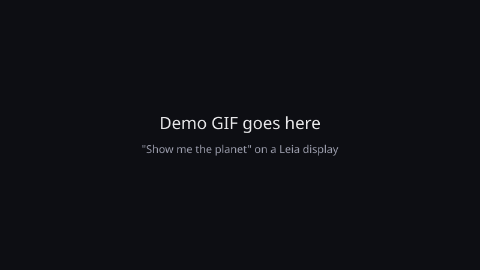
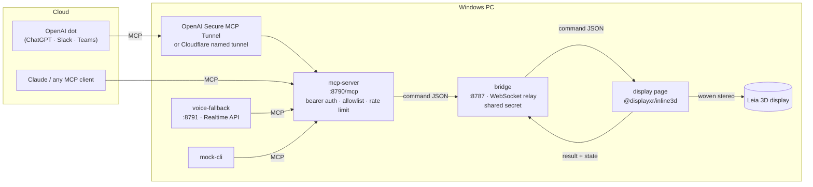

# displayxr-dot-voice

**Ask an AI agent to show something, and it appears in glasses-free 3D on a Leia display. In any
other browser it shows in 2D.**

<!-- GIF placeholder: replace with a capture of "show the planet" on a Leia display -->


Say "show me the planet" to an OpenAI dot (in ChatGPT, Slack or Teams), to the Realtime voice
fallback, or to Claude. The agent calls an MCP tool, the tool sends a command to your PC, and the
[DisplayXR](https://github.com/DisplayXR/displayxr-web) page renders the asset as a woven stereo
3D window.

## What it shows

- **glTF models**: CC0 low-poly models from Kenney, plus Khronos's PBR avocado from a pinned CDN URL
- **A Gaussian splat**: a procedural ringed planet, generated by `tools/make-splat.ts`
- **2D ↔ 3D switching** through the DisplayXR display-mode API
- **A 3D video call lobby** (DisplayXR `addCall`), gated by a Start button at the display

The tools are `list_assets`, `show_model(name|url)`, `show_splat(name|url)`, `set_mode(2d|3d)`,
`start_call()` and `clear()`.

## Hardware

- **For 3D:** a Leia (or other DisplayXR-supported) glasses-free 3D display on a **Windows** PC,
  running the [DisplayXR Browser](https://github.com/DisplayXR/displayxr-browser/releases).
- **For 2D:** any browser. Every SDK call falls back to a flat view you can orbit, so you can
  develop without the hardware.
- Node.js 24 or newer.

## 2-minute quick start (mock mode, no OpenAI account)

```bat
git clone https://github.com/joehillthunder/displayxr-dot-voice
cd displayxr-dot-voice
setup-windows.bat
```

The script installs dependencies, writes `.env` with random secrets, starts the bridge and the MCP
server in their own windows, and opens the display page. Then, in a new terminal:

```bat
npm run mock -- demo
```

You'll see the astronaut, the ambulance, the planet splat and the avocado in turn. For 3D, open
the same URL in the DisplayXR Browser. `npm run mock` with no arguments gives you a prompt
(`model apple`, `splat planet`, `mode 2d`, `call`, `clear`).

There's also a static copy of the display at
https://joehillthunder.github.io/displayxr-dot-voice/. Its buttons work with no backend.

## Connect a dot (or the fallback)

| Command source | Needs | Guide |
|---|---|---|
| OpenAI dots / ChatGPT | developer-mode custom MCP plugin + a tunnel | [docs/connect-dots.md](docs/connect-dots.md), [docs/tunnels.md](docs/tunnels.md) |
| Realtime voice fallback | `OPENAI_API_KEY`, a microphone | `setup-windows.bat voice`, then http://localhost:8791 |
| Claude / any MCP client | nothing extra | `claude mcp add --transport http displayxr http://127.0.0.1:8790/mcp --header "Authorization: Bearer <MCP_AUTH_TOKEN>"` |
| Mock CLI | nothing | `npm run mock` |

**Dots caveat:** OpenAI's docs say a dot can use "supported plugins". They don't say whether a
custom MCP plugin qualifies, so try it and use the voice fallback if it doesn't work.

## Architecture



| Folder | What it is |
|---|---|
| `mcp-server/` | Streamable HTTP MCP server (MCP TypeScript SDK v2). The only part that ever faces the internet. |
| `bridge/` | WebSocket relay plus a static server for `/display` and `/assets` on `localhost`. |
| `display/` | Static page: one inline-3D session, `addModel` / `addSplat` / `setStereoEnabled` / `addCall`, status overlay, 2D fallback. |
| `voice-fallback/` | Browser Realtime voice agent; its tools proxy to the MCP server. |
| `mock-cli/` | MCP client for testing with no OpenAI account. |
| `assets/` | CC0 models, the generated splat, `catalog.json`, [`LICENSES.md`](assets/LICENSES.md). |
| `docs/` | [Connecting agents](docs/connect-dots.md), [tunnels and security](docs/tunnels.md), [bridge protocol](docs/protocol.md). |

Every command source goes through the same MCP server, so one set of checks covers all of them:
the bearer token, the asset allowlist, the rate limit, and no filesystem or shell access.

## Why this matters (for OEM and platform partners)

- **Agents are becoming the interface.** People ask an agent for things instead of opening apps.
  This shows that a glasses-free 3D display can be a target for that request, using MCP, an open
  protocol, rather than one vendor's integration.
- **One integration, every agent.** The MCP server doesn't know which agent is calling. OpenAI
  dots, ChatGPT, Claude, Meta Muse or an in-house assistant all use the same six tools. An OEM
  ships the display-side half once.
- **Progressive by default.** The same page is a normal 2D page everywhere and turns 3D on
  DisplayXR hardware. Content and agent workflows don't fork per device.
- **Safe enough to leave running.** Allowlisted assets, rate limits, no filesystem access, and a
  camera that only a person at the display can turn on.
- **Small surface.** About 1,000 lines on top of `@displayxr/inline3d`, so it's easy to adapt into a
  retail kiosk, a product configurator, or a showroom concierge.

## Development

```sh
npm run typecheck
npm test                  # allowlist, rate limit, catalog, bridge auth/routing/static
node tools/make-splat.ts  # regenerate assets/splats/planet.ply
```

TypeScript runs directly on Node 24 (type stripping); there's no build step.

## License

Apache 2.0, see [LICENSE](LICENSE). Asset licenses are in [assets/LICENSES.md](assets/LICENSES.md).
